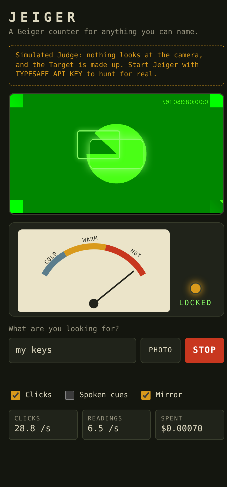

# Jeiger

A Geiger counter for anything you can name.

Type "my keys" (or show a photo of one sock), press Hunt, and sweep a camera around the room. The counter clicks. The more likely the thing is in view, the faster it clicks; the clicks lean left or right and rise or fall in pitch toward where it is; and when it sits in the middle of the view the counter locks on with a steady tone. You can hunt without looking at the screen at all.



This is a first prototype.

## Why this suits Jev

[Jev](https://docs.typesafe.ai) is TypeSafe's judgement model: it does not write text, it answers typed questions. Jev 1.14 can [look at images](https://docs.typesafe.ai/images.md). Jeiger asks it two questions about every camera frame, in one request:

| Question | Jev type | Becomes |
| - | - | - |
| Is the Target visible in this frame? | Noul, a probability from 0 to 1 | How fast the counter clicks |
| Where is it? | [Box](https://docs.typesafe.ai/primitives/box.md), four edges | Which way the clicks lean, and the box on screen |

Three properties of Jev carry the idea:

- **The answer is a number, not a sentence.** A probability can drive a click rate directly, and can be smoothed over time like any sensor signal.
- **It is cheap enough to ask continuously.** Input costs $0.042 per million tokens and output is free, so asking about frame after frame for minutes on end costs little. How many tokens a picture costs is not published yet; the page shows what the running server has spent so far.
- **A picture can go inside the question.** "Find the thing shown in this photo" needs no words at all, which is what the Photo button does.

## Run it

Needs Node 22.18 or newer.

```bash
npm install
npm run demo          # no API key: a made-up Target, to see and hear the counter
```

Open <http://localhost:4747>, type what to look for, press Hunt, and allow the camera. The demo runs on the Fake Jev: nothing looks at the camera, and a made-up Target drifts through the view so the counter passes through cold, warm, hot and locked.

With a key from TypeSafe:

```bash
TYPESAFE_API_KEY=... npm start
```

| Setting | Default | Meaning |
| - | - | - |
| `TYPESAFE_API_KEY` | none | The Jev API key. It stays on the server; the page never sees it. |
| `JEIGER_BUDGET_USD` | `0.25` | The Budget: once one running server has spent this much on Jev, Hunts stop. |
| `JEV_MODEL` | `jev-1.14.0` | Box questions need Jev 1.14. |
| `PORT` | `4747` | |

A laptop's webcam faces you, so the picture is shown mirrored and left and right are swapped to match. Jeiger assumes that for any camera that does not say it faces away; the Mirror switch turns it off.

## On a phone

Jeiger is a web page with a small server behind it, not an app from a store. A phone opens the page and can keep it on its home screen, where it starts full-screen like an app. The server still has to run somewhere the phone can reach, and over HTTPS: a browser gives a page the camera only on `localhost` or over HTTPS, so the laptop's plain `http://192.168...` address will not do.

1. **Give the server an HTTPS address.** Two ways:
   - *From your laptop, for a try-out.* Start Jeiger, then put a tunnel in front of it. With [cloudflared](https://developers.cloudflare.com/cloudflare-one/connections/connect-networks/downloads/) installed, `cloudflared tunnel --url http://localhost:4747` prints an `https://….trycloudflare.com` address. It lasts as long as the command runs and is a new address each time.
   - *Hosted, to keep.* Run `npm start` on any host that offers Node 22.18 or newer and HTTPS, with `TYPESAFE_API_KEY` set there.
2. **Open that address on the phone** and check that a Hunt works.
3. **Put it on the home screen.** iPhone: in Safari, Share, then "Add to Home Screen". Android: in Chrome, the menu, then "Install app" or "Add to Home screen".

Two things to know:

- **The page has no login.** Anyone who has the address can hunt on your Jev key. The Budget is what bounds the cost, so keep it small on an address others might find.
- **The home-screen icon is a bookmark to that address.** With a try-out tunnel it stops working when the tunnel does; add it again from the new address, or host Jeiger for an address that stays.

This has been checked in desktop Chromium only (it reads the manifest and reports nothing missing for installing). It has not been tried on a real phone.

## What has and has not been tested

- `npm test` covers the tracking and click logic, the Jev request and answer handling, the Budget, and the server over real HTTP. `npm run typecheck` checks the types, the page's code included.
- `node scripts/browser-check.cjs` drives the page in headless Chromium with a fake camera through a whole Hunt, down to the locked Phase and Stop. It needs Playwright, which is not in `package.json` (the script says how to get it). The page has no other tests.
- **Jev itself has not been called.** There was no API key when this was built, so every test runs against a Fake Jev that enforces Jev's documented request rules (`src/server/fake-jev.ts`). The first run with a real key is the first real test; [ADR 0001](docs/adr/0001-jev-is-called-over-plain-http-and-has-not-been-called-for-real.md) lists what was guessed.
- So nothing here says how *well* Jev finds things, or how fast it answers. TypeSafe itself calls image input "Dreamer-ready", not production-ready.

## How it works

```
camera ──frame──▶ server ──Noul + Box──▶ Jev
                    │
   page ◀──Reading──┘
     │
     ├─ tracker   Readings → Heat, Bearing, Phase
     ├─ clicker   Heat → random Clicks; Bearing → pan and pitch
     └─ cue       Bearing → "left", "up", "hold", "found" (spoken, optional)
```

- **One frame at a time, as fast as Jev answers.** The page sends a frame and waits. Only when the answer is back does it take the newest picture from the camera and send that. So there is never more than one request in the air per open page, and the pace is whatever Jev's answering time allows.
- **Readings and Clicks run at different speeds.** A Reading arrives when Jev has answered; Clicks are generated every few milliseconds from the current Heat. So the sound stays smooth however slowly Jev answers, and it fades to background ticking if Readings stop.
- **A box is believed only when the Noul is high.** Jev answers a Box question with a box even when the Target is not there, so the box is ignored unless the same frame's "is it visible?" says yes.
- **A failed request is never retried.** By then the camera has moved, so the next frame is sent instead. When Jev says it is busy or rate limits the account, the page waits before the next frame: half a second at first, twice as long each time it happens again, up to eight seconds.

The words used here (Hunt, Target, Exemplar, Frame, Reading, Heat, Bearing, Phase, Click, Budget) are defined in [CONTEXT.md](CONTEXT.md).

| Folder | Holds |
| - | - |
| `src/core` | The logic, pure and shared by the server's tests and the browser. |
| `src/server` | The Jev client (`judge.ts`), Hunts and the Budget, the HTTP server, the Fake Jev. |
| `src/web` | The page, and what a phone needs to put it on its home screen (the manifest and icons). |
| `tests` | One file per module, except the page (`src/web`) and the entry point (`main.ts`). |
| `scripts` | The browser check, and the script that renders the icons from `src/web/icon.svg`. |

## Where it could go

- **Look closer when warm.** Jev's guide suggests re-asking on a crop when a Box's confidence is low. A warm Reading could trigger one sharper second look.
- **Several Targets at once.** One request can carry many questions, so "keys, wallet, glasses" could each have their own click sound.
- **A hazard sweep.** "Anything a toddler could swallow" works as a Target as it stands; a mode that logs each find with its frame would make it a checklist.
- **Short frame history.** Jev accepts several frames in one request, so "is it getting closer?" is askable.
